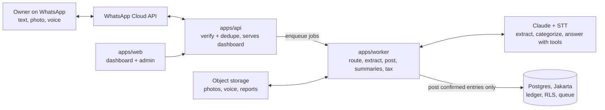

# BukuWA – MVP Design Spec

Version: 12 Nov 2026 · Source doc: https://claude.ai/artifact/NFpt1usqvWrhfePCQHm8hD

## 1. Overview

BukuWA (working name) is an AI bookkeeper that lives in WhatsApp. A UMKM owner sends receipts, transfer screenshots, voice notes or short texts; the agent records them in a proper ledger, answers questions about the business in Bahasa Indonesia, and prepares the monthly tax figure. The MVP must prove one thing: **owners keep sending transactions for 8+ weeks and pay for it**.

**Problem.** Most micro-sellers run their business through WhatsApp and a notebook. They do not know their real profit, mix personal and business money, and struggle with tax obligations now that enforcement on online sellers is tightening. Existing bookkeeping apps need forms and data entry, which owners abandon.

**MVP goals (12 weeks after build start)**

- 100 active paying businesses in one city / one vertical (suggested: home F&B and fashion resellers)
- 70% of transactions captured with no manual correction
- Week-8 retention of 40%+ (sent at least 3 transactions in week 8)
- Paid conversion of 15%+ after a 14-day free trial

**Non-goals for the MVP**

- Customer-facing sales chatbot (Meta's free WhatsApp Business AI already covers this)
- Direct tax filing into Coretax on the user's behalf
- Lending, payments or holding money
- Native mobile app (WhatsApp + web dashboard only)
- Multi-branch / multi-user businesses

## 2. Users and core jobs

The primary user is a solo owner or a husband-and-wife business, phone-only, selling through WhatsApp, Instagram, Shopee or TikTok Shop, with monthly turnover between Rp 10M and Rp 400M.

| Persona | Context | Main job | What they will pay for |
| --- | --- | --- | --- |
| Ibu Rina, home catering | 30 orders/week, paid by QRIS and transfer, buys ingredients at the pasar | "Tell me if I actually made money this month" | Daily/weekly profit summary without typing |
| Dimas, fashion reseller | Sells on WA + Shopee, 200 SKUs, supplier in Tanah Abang | "Know my stock and which supplier invoices are unpaid" | Stock + payables tracking from chat |
| Pak Hendra, small toko | Turnover near the tax threshold, worried about the tax office | "Know how much tax I owe and have proof" | Monthly tax figure + exportable report |
| Accountant / konsultan pajak (P1) | Serves 20–50 UMKM clients | "Get clean books from clients without chasing them" | Multi-client dashboard |

**Jobs-to-be-done the MVP must cover**

1. Record a sale or expense in under 10 seconds from WhatsApp.
2. See today's, this week's and this month's sales, costs and profit.
3. Keep business and personal money apart.
4. Track who owes me (receivables) and whom I owe (payables).
5. Know this month's estimated tax and keep evidence for it.

## 3. MVP key features

The MVP ships ten P0 features; everything else waits until retention is proven. Each P0 feature has a testable acceptance criterion that should become automated tests.

### P0 — must ship

| ID | Feature | What it does | Acceptance criteria |
| --- | --- | --- | --- |
| F1 | WhatsApp onboarding | Owner messages the number, gives business name, type, opening cash balance, and consents to the privacy policy in chat | New business is live in under 3 minutes; consent timestamp stored |
| F2 | Capture from text | "jual nasi box 25 x 18rb transfer BCA" becomes a sales entry | Correct amount, type, payment method on 90%+ of eval set; handles "rb", "jt", "k", "ceban", "goceng" |
| F3 | Capture from photos | Receipts, nota, QRIS / m-banking transfer screenshots, supplier invoices read by a vision model | Amount + date + counterparty correct on 85%+ of eval set; original image stored |
| F4 | Capture from voice notes | Voice note in Bahasa (incl. Javanese/Sundanese mixing) is transcribed and recorded | Amount + type correct on 80%+ of eval set |
| F5 | Confirm-before-post | Every extracted entry is echoed back as a short card with "OK / Ubah / Batal" buttons; low-confidence fields are asked about explicitly | Nothing reaches the ledger without a confirm or an auto-confirm rule the user enabled |
| F6 | Double-entry ledger + auto-categories | Each confirmed entry posts balanced journal lines to a simple UMKM chart of accounts; categories learned per business | Debits = credits for every journal; trial balance test passes |
| F7 | Ask your books | Questions like "untung minggu ini berapa?" or "siapa yang belum bayar?" answered from the ledger via tool calls, never from model memory | Every number in an answer comes from a SQL tool result; eval set 95%+ correct |
| F8 | Receivables & payables | "Bu Sari utang 350rb" creates a receivable; payment later closes it; optional reminder message drafted for the owner to forward | Open balances per contact always reconcile with ledger |
| F9 | Daily / weekly summary | Push message at a time the owner chooses: sales, costs, profit, cash, top items, unpaid invoices | Sent within 5 min of scheduled time; uses an approved WhatsApp template |
| F10 | Monthly tax estimate + report | Computes turnover-based final tax (rate and threshold configurable), produces a PDF/Excel monthly report with evidence links | Figures match ledger; report downloadable from WhatsApp link |

### Supporting P0 — web dashboard (light)

- Magic-link login sent via WhatsApp (no password)
- Transaction list with search, edit, delete (soft delete + audit log)
- P&L and cash-flow view by day / week / month
- Contacts with open receivables/payables
- Export to Excel and PDF
- Admin console for the team: businesses, message logs, extraction errors, manual review queue

### P1 — after the MVP proves retention

| ID | Feature | Why later |
| --- | --- | --- |
| P1-1 | Bank / e-wallet statement import (PDF/CSV) and auto-reconciliation | High value, but needs per-bank parsers and more trust |
| P1-2 | Simple stock tracking (in / out per SKU) | Only some segments need it |
| P1-3 | Accountant multi-client workspace | Second distribution channel; build after the core loop works |
| P1-4 | Credit-readiness score + lender referral | The fintech upside; needs 3–6 months of clean data per business |
| P1-5 | Invoice / payment-link generation | Requires a payment partner (e.g. a licensed PG) |
| P1-6 | Marketplace sales import (Shopee, Tokopedia/TikTok Shop) | API access and partnership work |

## 4. Key user flows

All flows start in WhatsApp; the dashboard is only for review and export. The bot always replies in short, casual Bahasa Indonesia and never posts to the ledger without confirmation.

**Flow A — Record a sale from a photo**

1. Owner forwards a BCA transfer screenshot.
2. Webhook stores the media, queues an extraction job, bot replies "Sebentar ya, lagi dibaca…" within 2 seconds.
3. Vision model returns structured JSON: amount Rp 450.000, date, sender "SARI W", bank BCA, confidence per field.
4. Bot sends a confirm card: "Pemasukan Rp 450.000 dari Sari W (transfer BCA), 12 Nov. Kategori: Penjualan. [OK] [Ubah] [Batal]".
5. If Sari has an open receivable of Rp 450.000, bot asks: "Ini pelunasan utang Bu Sari?"
6. On OK, journal is posted and the bot replies with today's running total.

**Flow B — Record an expense by voice**

1. Owner sends a voice note: "tadi belanja ayam 5 kilo 175 ribu, minyak 2 liter 38 ribu, cash".
2. Speech-to-text, then the extraction model splits it into two expense lines.
3. Confirm card lists both lines with a total; owner taps OK.

**Flow C — Ask a question**

1. Owner: "bulan ini untung berapa? dibanding bulan lalu?"
2. Agent calls `get_profit_and_loss(period=this_month)` and `get_profit_and_loss(period=last_month)`.
3. Bot answers with the two numbers, the change, and the top two cost drivers, plus a dashboard link.

**Flow D — Correct a mistake**

1. Owner: "yang tadi salah, harusnya 45rb bukan 450rb".
2. Agent finds the last entry, proposes a reversal + corrected entry, asks for confirmation.
3. The original journal is never edited; a reversing journal is posted (audit-safe).

**Flow E — Month-end tax**

1. On the 1st of each month the bot sends last month's turnover, the estimated final tax, and the payment deadline reminder.
2. Owner taps "Lihat laporan" to get a PDF report link.
3. Owner pays and files themselves (MVP), then sends the payment receipt photo; bot attaches it as evidence.

## 5. Architecture and stack

A webhook API answers WhatsApp fast, a background worker does the slow AI work, and one Postgres database in the Jakarta region holds the ledger and the job queue. The API and the worker share that database; the dashboard reads through the API.



The worker calls the models to draft entries, but only an owner-confirmed draft is posted to the ledger by the posting engine.

| Layer | Choice | Why |
| --- | --- | --- |
| Language | TypeScript everywhere (pnpm monorepo) | One language across API, worker and web |
| API | Hono (or Fastify) on Node | Small, fast webhook handling |
| Jobs | pg-boss on Postgres | No extra Redis to run at MVP scale |
| Database | Postgres 16 + Drizzle ORM, row-level security | Ledger integrity, tenant isolation |
| Web | Next.js + Tailwind + shadcn/ui | Fast dashboard and admin build |
| AI | Anthropic SDK (Haiku-class + Sonnet-class models), STT provider TBD | Structured outputs, tool use, vision |
| Messaging | WhatsApp Business Platform (Cloud API) via Meta or a local BSP | Interactive buttons, templates |
| Reports | react-pdf for PDF, exceljs for Excel | Generated in the worker |
| Hosting | Jakarta cloud region (e.g. GCP asia-southeast2: Cloud Run + Cloud SQL + Cloud Storage) | Data residency, low latency |
| Observability | Sentry + structured logs + per-business cost metrics | Catch extraction failures and cost drift |
| Testing | Vitest + the eval runner in CI | Accounting and AI quality gates |

## 6. Data model

The ledger is double-entry and append-only: entries are never updated, only reversed. Money is stored as integer rupiah (`bigint`), never floats. Every business-scoped table carries `business_id` and is protected by Postgres row-level security.

| Table | Key columns | Notes |
| --- | --- | --- |
| `businesses` | id, name, type, owner_phone, npwp (encrypted, optional), tax_profile_id, timezone, plan, trial_ends_at | One owner per business in MVP |
| `users` | id, business_id, phone_e164, role, consent_at, consent_version | Owner only in MVP; roles ready for staff/accountant |
| `accounts` | id, business_id, code, name, type (asset/liability/equity/income/expense), is_system | Seeded from a UMKM chart-of-accounts template |
| `contacts` | id, business_id, name, phone, kind (customer/supplier) | Created on the fly from chats |
| `journals` | id, business_id, date, description, source (text/photo/voice/manual), status, reverses_journal_id, created_by, created_at | Immutable after posting |
| `journal_lines` | id, journal_id, account_id, debit, credit, contact_id | DB constraint: sum(debit) = sum(credit) per journal |
| `captures` | id, business_id, wa_message_id, media_url, raw_text, transcript, extraction_json, confidence, status, model_version | Raw input + model output; links to journal once confirmed |
| `open_items` | id, business_id, contact_id, kind (receivable/payable), amount, due_date, settled_by_journal_id | Derived view or table, reconciled nightly |
| `category_rules` | id, business_id, pattern, account_id, hits | Per-business learning ("ayam" → Bahan baku) |
| `tax_profiles` | id, regime, rate_bps, annual_exempt_threshold, valid_from, valid_to | Config, not code: rules change |
| `messages` | id, business_id, direction, wa_message_id, type, body, template_name, cost, created_at | Full WhatsApp log for support and evals |
| `audit_log` | id, business_id, actor, action, entity, before, after, at | Every edit, export and login |

**Default chart of accounts (seed):** Kas, Bank, E-wallet, Piutang usaha, Persediaan, Utang usaha, Modal pemilik, Prive (owner drawings), Penjualan, Diskon penjualan, HPP / Bahan baku, Gaji, Sewa, Listrik & air, Transport & ongkir, Iklan & marketing, Biaya admin bank & marketplace, Beban pajak, Lain-lain.

## 7. AI engineering

The LLM extracts and explains; deterministic code does all accounting and arithmetic. The model never writes to the ledger directly and never states a number it did not get from a tool.

### 7.1 Pipeline

1. **Router** (small, fast model): classify each inbound message as `transaction`, `question`, `correction`, `command`, `chitchat` or `unsupported`.
2. **Extractor**: for `transaction`, return JSON matching a strict schema (Zod). Photos go to a vision-capable model; voice goes through speech-to-text first.
3. **Normalizer** (code): parse Indonesian money slang ("rb", "ribu", "jt", "k", "setengah juta", "ceban", "goceng"), dates ("kemarin", "Senin"), bank and e-wallet names; resolve contacts by fuzzy match.
4. **Categorizer**: per-business `category_rules` first, then the LLM with the chart of accounts as an enum. Store the rule when the owner confirms.
5. **Posting engine** (code): turn a confirmed extraction into balanced journal lines.
6. **Q&A agent**: tool-calling loop for questions and corrections (tools below).

### 7.2 Extraction schema (sketch)

```json
{
  "entries": [{
    "kind": "sale | expense | transfer_in | transfer_out | receivable | payable | settlement | owner_drawing | owner_capital",
    "amount_idr": 450000,
    "date": "2026-11-12",
    "counterparty": "Sari W",
    "payment_method": "cash | bank:BCA | ewallet:GoPay | qris | other",
    "items": [{"name": "nasi box", "qty": 25, "unit_price_idr": 18000}],
    "suggested_account": "Penjualan",
    "confidence": {"amount": 0.98, "date": 0.9, "counterparty": 0.7}
  }],
  "needs_clarification": ["counterparty"]
}
```

### 7.3 Agent tools (Q&A and corrections)

| Tool | Purpose |
| --- | --- |
| `get_profit_and_loss(period)` | Income, expenses, profit for a period |
| `get_cash_position()` | Balances of Kas, Bank, E-wallet |
| `list_transactions(filters)` | Search entries by date, contact, category, amount |
| `get_open_items(kind, contact?)` | Receivables / payables |
| `propose_entry(extraction)` | Create a draft and send a confirm card |
| `propose_reversal(journal_id, corrected?)` | Draft a correction |
| `get_tax_estimate(month)` | Turnover-based tax estimate from `tax_profiles` |
| `create_report_link(type, period)` | Signed, expiring link to PDF/Excel |

Tools are read-only or produce drafts; only an owner button press posts to the ledger.

### 7.4 Models

- Router + simple text extraction: Claude Haiku-class model (cheap, fast).
- Photo extraction and multi-step Q&A: Claude Sonnet-class model.
- Speech-to-text: benchmark 2–3 providers on 100 real Indonesian voice notes before choosing.
- Keep model names in config; log `model_version` on every capture so evals can compare.
- Target cost: under Rp 3.000 per active business per month in model + messaging spend at MVP volumes (validate in week 2).

### 7.5 Evals (the real moat)

- Build a golden set from day one: 300 texts, 300 images (receipts, nota, BCA/BRI/Mandiri/BNI/GoPay/OVO/DANA/QRIS screenshots), 100 voice notes, 100 questions with expected answers. Collect with consent from pilot users; strip personal data.
- Run evals in CI on every prompt or model change; fail the build if field accuracy drops more than 2 points.
- Track in production: % auto-confirmed, % edited, % cancelled, per field and per input type.
- Weekly review of the manual review queue feeds new eval cases.

## 8. Tax, security and compliance

The MVP estimates tax and prepares evidence; it does not file or give tax advice. All tax rules live in the `tax_profiles` table so a regulation change is a data update, not a deploy.

### 8.1 Tax module (MVP scope)

- Default profile: final income tax on gross turnover for individual UMKM at 0.5%, for turnover up to Rp 4.8B a year ([DDTCNews](https://news.ddtc.co.id/berita/nasional/1813909/perpanjang-pph-final-umkm-kemenkeu-mulai-revisi-pp-552022)). Individuals are exempt on the first Rp 500M of yearly turnover under PP 55/2022; track cumulative turnover from January.
- Regulatory status to watch: the government announced the 0.5% scheme continues to 2029 for individuals, via a revision of PP 55/2022 ([Pajakku](https://pajakku.com/artikel/pph-final-05-untuk-umkm-wp-pribadi-diperpanjang-hingga-2029)). The revision was reported as awaiting final sign-off and may tighten eligibility, for example against splitting turnover ([Pajakku](https://pajakku.com/artikel/sederet-aturan-pph-final-umkm-yang-bakal-berubah-lewat-revisi-pp-552022)). Confirm the final text with a konsultan pajak before launch.
- Output per month: gross turnover, cumulative year-to-date turnover, exempt portion used, estimated tax, deadline reminder, list of evidence (captures linked to each sale).
- Every tax screen and message carries a short disclaimer: estimate only, not tax advice.
- P1: guided filing checklist for Coretax and a partnership with a licensed tax consultant for paid filing.

### 8.2 Security

- Postgres row-level security on every business-scoped table; tests that one business can never read another's rows.
- Encrypt NPWP/NIK and phone numbers at rest (pgcrypto or app-level envelope encryption).
- Media in private object storage; signed URLs that expire in 15 minutes.
- Verify WhatsApp webhook signatures; idempotency on `wa_message_id` to avoid double-posting.
- Secrets in a managed secret store; no keys in the repo.
- Audit log on every edit, export and login; dashboard sessions expire after 7 days.

### 8.3 Privacy and regulatory

- Indonesia's Personal Data Protection Law (UU PDP 27/2022): explicit consent at onboarding, a privacy notice in Bahasa, data export and deletion on request, a named data-protection contact.
- Host the database and media in an Indonesian cloud region (Jakarta) from day one; it simplifies enterprise and bank partnerships later.
- Do not send NIK/NPWP to the LLM; mask them before any model call.
- Use an LLM provider configuration that does not train on customer data.
- No money movement, lending or payments in MVP, so no OJK / Bank Indonesia licence is needed yet. The P1 lender-referral feature needs a legal review first.
- WhatsApp Business Platform policy: use approved templates for proactive messages (summaries, reminders); stay within the 24-hour service window for everything else.

## 9. Building it with Claude Code

One TypeScript monorepo, built milestone by milestone, with tests and evals written before each feature is called done. Give Claude Code one milestone per session, with this spec and CLAUDE.md in the repo.

### 9.1 Repo layout

```text
bukuwa/
  CLAUDE.md                 # rules for Claude Code
  docs/spec.md              # this document
  apps/
    api/                    # Hono or Fastify: WhatsApp webhook, REST for dashboard
    worker/                 # pg-boss jobs: extraction, STT, summaries, reports
    web/                    # Next.js dashboard + admin console
  packages/
    db/                     # Drizzle schema, migrations, RLS policies, seeds (chart of accounts)
    ledger/                 # posting engine, reversals, reports (pure functions, 100% tested)
    ai/                     # router, extractor, categorizer, agent tools, prompts
    wa/                     # WhatsApp Cloud API client, templates, interactive buttons
    idn/                    # Indonesian parsers: money slang, dates, banks, e-wallets
    tax/                    # tax_profiles logic and monthly estimate
  evals/
    datasets/               # golden sets (text, image, voice, questions) - PII-free
    run.ts                  # scores field accuracy, fails CI on regression
  infra/                    # Terraform/Docker for Jakarta-region hosting
```

### 9.2 CLAUDE.md

See `CLAUDE.md` at the repo root.

### 9.3 Build milestones (about 10 weeks for 1–2 engineers)

1. **Weeks 1–2 — Foundations.** Monorepo, Postgres schema + RLS, chart-of-accounts seed, ledger package with balanced-journal and reversal tests, WhatsApp webhook with signature check and idempotency, onboarding flow (F1).
2. **Weeks 2–3 — Text capture.** `idn` parsers, router, text extractor, confirm card with buttons, posting engine (F2, F5, F6). First 300-case text eval set.
3. **Weeks 4–5 — Photos and voice.** Media storage, vision extraction for receipts and transfer screenshots, STT benchmark and integration, multi-line entries (F3, F4). Image and voice eval sets.
4. **Week 6 — Ask your books + corrections.** Agent tool loop, read-only SQL tools, reversal flow (F7, Flow D). Question eval set.
5. **Week 7 — Receivables, payables, summaries.** Open items, settlement matching, scheduled summaries via templates (F8, F9).
6. **Week 8 — Tax and reports.** Tax profiles, monthly estimate, PDF/Excel reports, signed links (F10).
7. **Week 9 — Dashboard + admin.** Magic-link login, transaction list, P&L, contacts, exports, review queue.
8. **Week 10 — Hardening and pilot.** Load test, cost monitoring per business, privacy notice, onboarding 20 pilot businesses.

### 9.4 Example first prompt for Claude Code

```text
Read docs/spec.md and CLAUDE.md. Implement Milestone 1 only.
Start with packages/db (Drizzle schema for businesses, users, accounts, journals,
journal_lines, captures, messages, audit_log; RLS policies; chart-of-accounts seed)
and packages/ledger (postJournal, reverseJournal, trialBalance) with Vitest tests,
including a cross-tenant RLS test and a test that unbalanced journals are rejected.
Then add the WhatsApp webhook in apps/api with signature verification and
idempotency on wa_message_id. Stop and summarize when tests pass.
```

## 10. Metrics, risks and open questions

The pilot succeeds if retention and paid conversion hit target. Accuracy alone is not enough.

| Metric | Target at pilot end | How measured |
| --- | --- | --- |
| Week-8 retention | 40%+ | Businesses with 3+ transactions in week 8 / cohort |
| Transactions per active business per week | 15+ | `journals` count |
| Auto-confirm rate (no edit) | 70%+ | `captures` confirmed without change |
| Q&A answer accuracy | 95%+ | Eval set + weekly sample review |
| Trial to paid conversion | 15%+ | Billing |
| Cost per active business per month | Below Rp 3.000 AI + messaging | Token and message logs |
| Median reply time | Under 4 s for text, under 12 s for photos | Message timestamps |

**Key risks and mitigations**

- **Meta or a big player bundles bookkeeping into WhatsApp Business** → go deep on ledger, tax and evidence; add the accountant channel early.
- **Owners stop sending after 2–3 weeks** → daily summary with one useful insight; weekly "you saved X hours"; test reminder timing.
- **Extraction errors break trust** → confirm-before-post, reversals, visible evidence, review queue.
- **Tax rules change** → rules as data, a tax advisor on retainer, clear "estimate only" wording.
- **WhatsApp messaging costs or policy shifts** → monitor cost per business; keep the dashboard usable on its own.

**Open questions**

- [ ] Which first vertical and city for the pilot (home F&B in Jakarta/Bandung vs fashion resellers)?
- [ ] Pricing: flat Rp 99k/month, or a free tier with paid reports and tax?
- [ ] Distribution partner: a bank, a POS vendor, or an UMKM community / association?
- [ ] Which speech-to-text provider performs best on mixed Javanese-Indonesian voice notes?
- [ ] Has the PP 55/2022 revision been signed, and what changed in eligibility?
